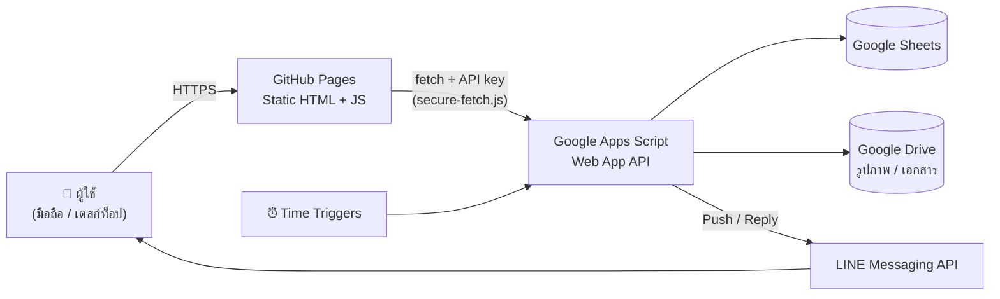

<div align="center">

# 🚑 SAND ระบบยานพาหนะ

**Sansai Administration Network Drive · Fleet Management**

ระบบบริหารจัดการยานพาหนะ โรงพยาบาลสันทราย จังหวัดเชียงใหม่ (เขตสุขภาพที่ 1)
บันทึกการใช้รถ ตรวจสภาพรถ แจ้งซ่อม ตารางเวร พขร. และแจ้งเตือนผ่าน LINE ในระบบเดียว


</div>

---

## 🎨 ชุดแบรนด์ SAND (มาสคอต · ไอคอน · วิดเจ็ตแจ้งเตือน)


| ส่วน | รายละเอียด |
|---|---|
| วิดเจ็ตรถยังไม่ตรวจสภาพ | มุมขวาล่างของ **หน้าแรกและตารางเวร** · แสดงเฉพาะก่อน 10:00 น. (เวลาไทย) · ปุ่มกลม 56px แตะแล้วขยายรายการ · "ซ่อนวันนี้" · หลบ UI เดิมอัตโนมัติ · ใช้ API เดิม `getStatusSummary` ไม่ต้องแก้ Code.gs |
| ไอคอน 12 ตัว | การ์ดเมนู การ์ดสถานะ และ header ของทุกหน้า |
| มาสคอต 4 ท่า | ทักทาย (หน้าแรก) · เข้าสู่ระบบ (swap) · ไม่มีข้อมูล (empty-state) · สำเร็จ (modal) |
| ภาพเคลื่อนไหว WebP | `wave` hero · `loading` ทุกหน้า · `alert` วิดเจ็ต (มี `-still` สำหรับผู้ลดการเคลื่อนไหว) |
| ดูทั้งหมด | เปิด `brand.html` |

ไฟล์ที่เพิ่ม: `css/sand-brand.css`, `js/sand-brand.js`, `brand.html`, `assets/sand/`, `tools/slice_sheet.py`, `skills/sand-brand-kit/`

**ปรับค่า** — เวลาตัด/หน้าที่แสดงวิดเจ็ต อยู่ที่ `CFG` ต้นไฟล์ `js/sand-brand.js` (`cutoffMinutes`, `reminderPages`)
**สร้างสินทรัพย์ใหม่จากชีต** — `pip install pillow numpy opencv-python && python3 tools/slice_sheet.py`

> หน้าเดิมอ้างไฟล์ `assets/sand-logo-icon.png`, `assets/favicon-*.png`, `assets/apple-touch-icon.png` ซึ่งอยู่ในโฟลเดอร์ `assets/` ของ repo จริงอยู่แล้ว — ชุดนี้เพิ่มเฉพาะ `assets/sand/` และ `assets/source/` จึงไม่ชนกัน

---

## 📌 ภาพรวม

SAND ระบบยานพาหนะ พัฒนาขึ้นเพื่อแทนการจดบันทึกด้วยกระดาษ ให้พนักงานขับรถ (พขร.) และผู้บริหารมองเห็นสถานะรถ เลขไมล์ การเติมน้ำมัน และภาระงานได้แบบเรียลไทม์ ผ่านเบราว์เซอร์บนมือถือโดยไม่ต้องติดตั้งแอปเพิ่ม

| ด้าน | รายละเอียด |
|---|---|
| ผู้ใช้งาน | ผู้บริหาร, รองฯ, พนักงานขับรถ, เจ้าหน้าที่ธุรการ |
| สถาปัตยกรรม | Static frontend (GitHub Pages) + REST-style API (Google Apps Script) |
| ฐานข้อมูล | Google Sheets + Google Drive (เก็บรูปภาพ) |
| การแจ้งเตือน | LINE Messaging API (push แบบตั้งเวลา + ตอบสดผ่าน Rich Menu) |

## ✨ ฟีเจอร์หลัก

### 🚗 การใช้รถและบำรุงรักษา
- **บันทึกการใช้รถ** (`startmile.html`) เลขไมล์ต้น–ปลายทาง จุดหมาย การเติมน้ำมัน พร้อมแนบรูปถ่าย
- **ตรวจสภาพรถประจำวัน** (`check.html`) รายงานการตรวจสภาพรถยนต์พร้อมรูปประกอบ
- **แจ้งซ่อมยานพาหนะ** (`fixedcar.html`) แจ้งซ่อมและติดตามสถานะงานซ่อม
- **แก้ไขเลขไมล์** (`editmile.html`) ขั้นตอนขออนุมัติแก้ไข/ลบข้อมูล และตรวจจับค่าไมล์ผิดปกติ
- **ประเมินความพึงพอใจ** (`satisfaction.html`) แบบประเมินการใช้รถ

### 🚨 งาน EMS
- **ตรวจอุปกรณ์ EMS** (`EMScheck.html`) เช็คและเติมอุปกรณ์ประจำรถพยาบาล
- **แดชบอร์ด EMS** (`emsDashboard.html`) ภาพรวมการตรวจ ป้องกันด้วยรหัสผ่าน (SHA-256)

### 📅 ตารางเวรและการแลกเวร
- **ตารางเวรยานพาหนะ** (`worktable.html`) ตารางเวรรายเดือน ตารางงานประจำวัน
- **ระบบแลกเวร พขร.** (`swap.html`) ยื่นคำขอแลกเวร พร้อมตรวจสอบความขัดแย้งของเวรฝั่งเซิร์ฟเวอร์ อนุมัติ/ปฏิเสธ และสร้างบันทึกข้อความ (Google Docs + PDF) อัตโนมัติ รวมทั้งรายงานสรุปรายเดือน

### 📊 ภาพรวมและแผนที่
- **แผงควบคุม** (`dashboard.html`) สถานะรถ สถิติการใช้งาน
- **แผนที่เส้นทาง** (`routemap.html`) แสดงเส้นทางด้วย Leaflet + OSRM และหมุดสถานที่
- **ตรวจจับปั๊มน้ำมัน** อัตโนมัติจากคำสำคัญของสถานที่

### 💬 LINE Integration
- รายงานตั้งเวลาอัตโนมัติ (เช่น รายงานตรวจรถ, ตารางงานประจำวัน 07:30 น., รายงานสัปดาห์)
- **Rich Menu** ตอบสด: "สถานะรถ" และ "ตารางงานของฉัน"
- กำหนดสิทธิ์ตามบทบาท (แอดมิน / รองฯ / พขร.) และบันทึกประวัติการส่งพร้อมปุ่มส่งซ้ำ (`linecontrol.html`)

## 🏗️ สถาปัตยกรรม



**หลักการออกแบบ**
- Backend (`gas/Code.gs`) ทำหน้าที่เป็น API: `doGet` สำหรับอ่านข้อมูล, `doPost` สำหรับบันทึก
- ทุก request ผ่านการตรวจ API key แบบ **fail-closed** (หากไม่ได้ตั้งค่าคีย์ จะปฏิเสธทุกคำขอ)
- ใช้ `LockService` ป้องกันการเขียนข้อมูลชนกัน
- อ้างอิงคอลัมน์ด้วย **ชื่อหัวตาราง** แทนตำแหน่งตายตัว เพื่อให้ปรับโครงสร้างชีทได้โดยไม่พัง
- บันทึกการเข้าถึง API ทุกครั้ง (action, IP, ผลการอนุญาต)

## 📁 โครงสร้างโปรเจกต์

```
carsystemsansai/
├── index.html · dashboard.html · startmile.html · check.html · editmile.html
├── fixedcar.html · EMScheck.html · emsDashboard.html · routemap.html
├── worktable.html · swap.html · satisfaction.html · qr-satisfaction.html
├── linecontrol.html · brand.html · credits.html     # หน้าเว็บ (อยู่ที่ราก เพื่อให้ลิงก์/QR/Rich Menu เดิมใช้ได้)
├── manifest.webmanifest  # PWA (ต้องอยู่ที่ราก)
├── css/                  # สไตล์ที่ใช้ร่วม
│   ├── sand-brand.css        # ชุดแบรนด์ + วิดเจ็ตแจ้งเตือน
│   ├── route-card.css        # การ์ดแผนที่เส้นทาง (index)
│   └── monthly-report.css    # รายงานประจำเดือน (dashboard)
├── js/                   # สคริปต์ฝั่งเว็บ
│   ├── secure-fetch.js       # แนบ API key + client IP ให้ทุก request
│   ├── sand-brand.js         # วิดเจ็ตรถยังไม่ตรวจสภาพ + ไอคอนประจำหน้า
│   ├── route-card.js         # แผนที่เส้นทางในหน้ารายละเอียดรถ
│   ├── monthly-report.js     # รายงานประจำเดือน (PDF)
│   ├── monthly-gis.js        # วิเคราะห์เชิงพื้นที่ (GIS) ในรายงานประจำเดือน
│   └── monthly-html.js       # รายงานประจำเดือนแบบ HTML โต้ตอบ (แท็บ/ค้นหา/เรียงตาราง/กราฟ/โหมดมืด)
├── gas/Code.gs           # Google Apps Script (backend) ไฟล์เดียว — ดู gas/README.md
├── assets/               # รูป · มาสคอต · ไอคอน · QR
├── docs/                 # เอกสารประกอบ (UPLOAD*.md, CREDITS.md)
├── tools/                # สคริปต์ช่วยสร้างสินทรัพย์ (Python)
├── skills/               # sand-brand-kit
├── archive/legacy-gas/   # ไฟล์ GAS รุ่นเก่า (admin/duty/send_core) — ห้าม deploy
└── README.md
```

> Backend คือไฟล์เดียว `gas/Code.gs` — วิธี deploy ดู [`gas/README.md`](gas/README.md)

## 🚀 การติดตั้ง

### 1) เตรียม Backend (Google Apps Script)
1. สร้าง Google Sheet และเปิด **Extensions → Apps Script**
2. วางโค้ด `gas/Code.gs` แล้วรันฟังก์ชัน setup เพื่อสร้างชีทที่จำเป็น (เช่น `setupAllSheets`, `setupSwapRequestsSheet`, `setupJobAssignmentsSheet`)
3. ตั้งค่า **Project Settings → Script Properties**

   | Key | คำอธิบาย |
   |---|---|
   | `API_KEY` | รหัสสำหรับตรวจสอบคำขอจากหน้าเว็บ (สุ่มสตริงยาวๆ) |
   | `LINE_CHANNEL_ACCESS_TOKEN` | Channel access token ของ LINE Official Account |

4. **Deploy → New deployment → Web app** (Execute as: *Me*, Access: ตามนโยบายหน่วยงาน) แล้วคัดลอก URL
5. รัน `setupReportTriggers` เพื่อตั้งเวลาส่งรายงาน LINE และตั้ง Time Trigger สำหรับรีเซ็ตสถานะรายวัน

### 2) เตรียม Frontend
1. กำหนด `GAS_URL` ในแต่ละหน้าให้ชี้ไปยัง Web App URL ข้างต้น
2. ตั้งค่า `API_KEY` ใน `js/secure-fetch.js` ให้ตรงกับ Script Properties
3. Push ขึ้น GitHub แล้วเปิด **Settings → Pages** เลือก branch `main`

### 3) เชื่อม LINE (ถ้าใช้งาน)
1. ตั้ง Webhook URL ของ LINE Official Account ให้ชี้ไปที่ Web App
2. ผู้ติดตามจะถูกลงทะเบียนในชีท `LineUsers` อัตโนมัติ — แอดมินกำหนดคอลัมน์ **บทบาท** และ **เบอร์โทร (พขร.)**
3. ตั้งค่าปุ่ม Rich Menu ให้ตรงกับ postback/ข้อความที่กำหนดในโค้ด

## 🗂️ ชีทข้อมูลหลัก

| ชีท | หน้าที่ |
|---|---|
| `ตารางเวร` / `ตารางเวรถัดไป` | ตารางเวร พขร. รายเดือน |
| `ตารางงาน` | มอบหมายงานรายวัน |
| `คำขอแลกเวร` | คำขอและประวัติการแลกเวร |
| `LineUsers` | ผู้รับ LINE, บทบาท, เบอร์โทร |
| `LineSendLog` | ประวัติการส่งข้อความ LINE |

## 🔐 ความปลอดภัยและ PDPA

- ระบบออกแบบสำหรับ **ใช้ภายในหน่วยงาน** (ผู้บริหารและ พขร.)
- ตรวจสอบ API key ทุกคำขอ และบันทึก log การเข้าถึง
- การแก้ไข/ลบเลขไมล์ต้องผ่านรหัสแอดมินหรือขั้นตอนอนุมัติ
- แดชบอร์ด EMS ป้องกันด้วยรหัสผ่านแบบแฮช SHA-256
- ข้อมูลส่วนบุคคล (ชื่อ เบอร์โทร รูปถ่าย) ใช้เพื่อการบริหารงานยานพาหนะเท่านั้น
- **ห้าม commit** ค่า token/secret จริงลง repository สาธารณะ

## 🗺️ แผนที่เส้นทางในการ์ดรถ (index.html)

เมื่อกดการ์ดรถที่ **กำลังใช้งาน** จะแสดงเส้นทาง รพ. → ปลายทาง พร้อมระยะทาง เวลาเดินทางโดยประมาณ เวลาออก/ผ่านมา เวลาที่คาดว่าถึง และผู้ขับ

- พิกัดปลายทางมาจากชีท `Locations` (ปักหมุดที่หน้า `routemap.html`) — ปลายทางที่ยังไม่ปักหมุดจะไม่วาดเส้นทาง แต่มีปุ่มเปิดใน Google Maps
- เส้นทางถนนจริงจาก OSRM · ภาพแผนที่จากไทล์ OpenStreetMap (ตัวเดียวกับ `routemap.html`) (ไม่ต้องใช้ API key)
- เวลาเดินทางเป็นค่าประมาณ ไม่ใช่ตำแหน่งจริงของรถ (ระบบไม่มี GPS)
- โค้ด: `js/route-card.js`, `css/route-card.css`

## 📄 รายงานประจำเดือน (PDF) บน Google Drive (dashboard.html)

การ์ด "รายงานประจำเดือน (PDF)" ในหน้า Dashboard สรุปผลการใช้งานระบบของเดือน — จำนวนเที่ยว/ระยะทาง/น้ำมัน (ตอนออก+ตอนกลับ) รายคัน รายพขร. ปลายทางที่ไปบ่อย การตรวจสภาพรถ/รายการผิดปกติ ความพึงพอใจ และเทียบกับเดือนก่อน

- สร้าง PDF (A4) ในเบราว์เซอร์จากข้อมูลล่าสุด แล้วส่งไปเก็บในโฟลเดอร์ Google Drive **"SAND รายงานประจำเดือน"** (ชื่อไฟล์ `SAND_Monthly_YYYY-MM.pdf`)
- เมื่อขึ้นเดือนใหม่ และมีคนเปิด Dashboard ระบบจะสร้างรายงานเดือนที่แล้วให้อัตโนมัติ 1 ครั้ง (ไม่มี trigger ฝั่งเซิร์ฟเวอร์) หรือกดสร้างเองเลือกเดือนย้อนหลังได้ 12 เดือน
- เปิดดู/ดาวน์โหลดผ่านหน้า Dashboard ได้เลย ไฟล์ไม่ถูกแชร์สาธารณะ
- Apps Script: `getMonthlyReports`, `getMonthlyReportFile`, `saveMonthlyReport` (อยู่ใน `gas/Code.gs` · ต้อง deploy เวอร์ชันใหม่) · โค้ดหน้าเว็บ: `js/monthly-report.js`, `js/monthly-gis.js`, `css/monthly-report.css`

## 📈 สถิติการใช้งาน

หน้าเว็บฝังตัวติดตามจาก SAND Office Tools เพื่อดูจำนวนผู้เข้าใช้ โดยไม่ใช้คุกกี้และไม่เก็บ IP

```html
<script defer src="https://sandtools.vercel.app/t.js" data-site="prnskn2arc"></script>
```

## 🛠️ เทคโนโลยีที่ใช้

Google Apps Script · Google Sheets · Google Drive · Google Docs · HTML5 · CSS3 · Vanilla JavaScript · Leaflet · OSRM · LINE Messaging API · GitHub Pages

## 👥 เครดิต

**นายจันทกรณ์ จีกัน (Chanthakon Chikan)**
นักวิชาการสาธารณสุขชำนาญการ กลุ่มงานพัฒนาคุณภาพบริการและมาตรฐาน
โรงพยาบาลสันทราย จังหวัดเชียงใหม่
โทรศัพท์: 053-921-199 ต่อ 168

## 📄 License

เผยแพร่ภายใต้ [MIT License](LICENSE) — Copyright © 2026 Chanthakon Chikan

---

<div align="center">
<sub>© 2026 Chanthakon Chikan · โรงพยาบาลสันทราย · <a href="LICENSE">MIT License</a></sub>
</div>
